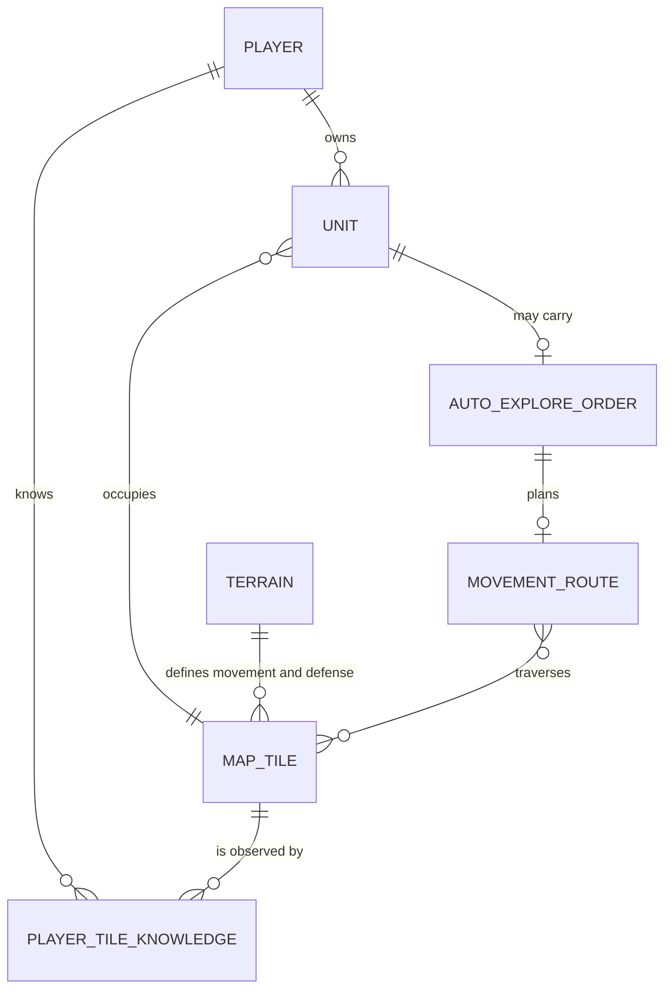

# CTP2 Auto-Explore Entity Model

**Status:** Draft conceptual model
**Requirements:** [AE-REQ-001–AE-REQ-006](../reqs/ctp2-auto-explore.rst)
**Design:** [ctp2-auto-explore-design.md](ctp2-auto-explore-design.md)

This feature-scoped model does not change `docs/entity_model.md`, which describes the Masters of Magic movement test data. It distinguishes existing game concepts from the proposed order and transient planning values. Field names are conceptual until reconciled with the C++ source.

## Entity Relationship Diagram

### PLAYER

Represents the player whose current map knowledge limits Auto-Explore decisions.

| Attribute | Description | Data Type | Length/Precision | Validation Rules |
|---|---|---|---|---|
| id | Existing player identifier | Long | 19 | Primary Key, Sequence |

### UNIT

Represents the existing CTP2 unit receiving the native order.

| Attribute | Description | Data Type | Length/Precision | Validation Rules |
|---|---|---|---|---|
| id | Existing unit identifier | Long | 19 | Primary Key, Sequence |
| owner_id | Owning player | Long | 19 | Not Null, Foreign Key (PLAYER.id) |
| current_tile_id | Current map position | Long | 19 | Not Null, Foreign Key (MAP_TILE.id) |
| movement_profile | Native movement type used for reachability and cost | String | 50 | Not Null |

### TERRAIN

Provides the movement and defensive values already used by CTP2.

| Attribute | Description | Data Type | Length/Precision | Validation Rules |
|---|---|---|---|---|
| id | Existing terrain identifier | Long | 19 | Primary Key, Sequence |
| native_movement_cost | Cost supplied by existing movement rules | Integer | 10 | Not Null, Min: 0 |
| defense_value | Applicable defense value used to compare safe posture tiles | Integer | 10 | Not Null, Min: 0 |

### MAP_TILE

Represents a map location whose terrain and improvement may affect a route.

| Attribute | Description | Data Type | Length/Precision | Validation Rules |
|---|---|---|---|---|
| id | Existing map-tile identifier | Long | 19 | Primary Key, Sequence |
| terrain_id | Terrain at the location | Long | 19 | Not Null, Foreign Key (TERRAIN.id) |
| owner_id | Territory owner when present | Long | 19 | Optional, Foreign Key (PLAYER.id) |
| road_present | Whether a road improvement exists | Boolean | 1 | Not Null |

### PLAYER_TILE_KNOWLEDGE

Represents the acting player's explored and currently visible state for one tile.

| Attribute | Description | Data Type | Length/Precision | Validation Rules |
|---|---|---|---|---|
| player_id | Player whose knowledge is represented | Long | 19 | Primary Key, Foreign Key (PLAYER.id) |
| tile_id | Known map tile | Long | 19 | Primary Key, Foreign Key (MAP_TILE.id) |
| explored | Whether the tile is already explored | Boolean | 1 | Not Null |
| currently_visible | Whether current unit visibility includes the tile | Boolean | 1 | Not Null |

### AUTO_EXPLORE_ORDER

Represents the active executable order attached to a unit; storage must use the engine's native unit-order mechanism.

| Attribute | Description | Data Type | Length/Precision | Validation Rules |
|---|---|---|---|---|
| unit_id | Unit carrying the order | Long | 19 | Primary Key, Foreign Key (UNIT.id) |
| order_state | Active, defensive posture, completed, or cancelled lifecycle state | String | 20 | Not Null, Values: ACTIVE, DEFENSIVE, COMPLETE, CANCELLED |
| stop_reason | Reason the order ended, when ended | String | 40 | Optional |

### MOVEMENT_ROUTE

Represents a transient path proposal that is recomputed when the map or order changes.

| Attribute | Description | Data Type | Length/Precision | Validation Rules |
|---|---|---|---|---|
| id | Route proposal identifier | Long | 19 | Primary Key, Sequence |
| unit_id | Unit for which the route was planned | Long | 19 | Not Null, Foreign Key (UNIT.id) |
| total_native_cost | Cost under the unit's normal movement rules | Integer | 10 | Not Null, Min: 0 |
| planned_path | Ordered tile identifiers for this transient route | String | 500 | Not Null |

## Model Constraints

- `PLAYER_TILE_KNOWLEDGE` is owner-scoped; the planner cannot consult another player's hidden map.
- `MOVEMENT_ROUTE` is transient and must be recalculated after a movement segment, visibility change, blocked step, or replacement order.
- The entity names and fields above are a conceptual design, not evidence of existing C++ class or save-file layouts.
